# Footprints in wet sand

An interactive isometric figure, built with the [Anatomy](https://github.com/wheresryan22/anatomy) skill: a block of beach cut from the swash zone, a strip of smooth, dark, wet sand 2.7 m long and 1.7 m across, rising 1 in 12, with a band of shallow sea lapping along its back edge.

<p align="center">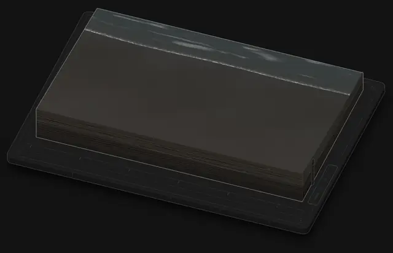</p>

| | Light | Dark |
|---|---|---|
| A foot presses in, heel first, ringed by pale drained sand | 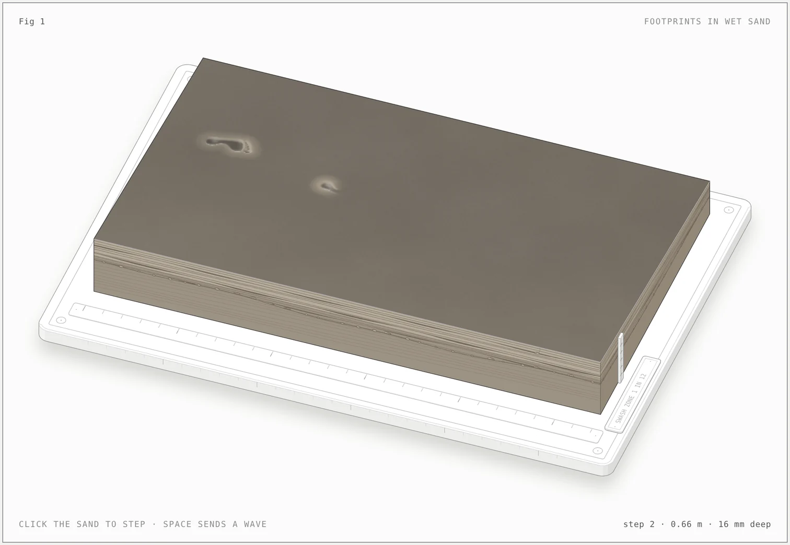 | 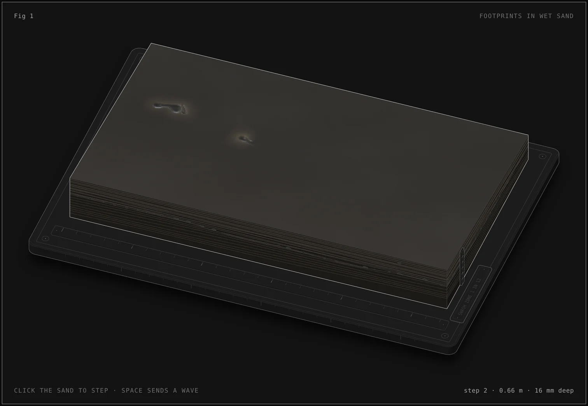 |
| Four prints, water pooled in the heels and balls | 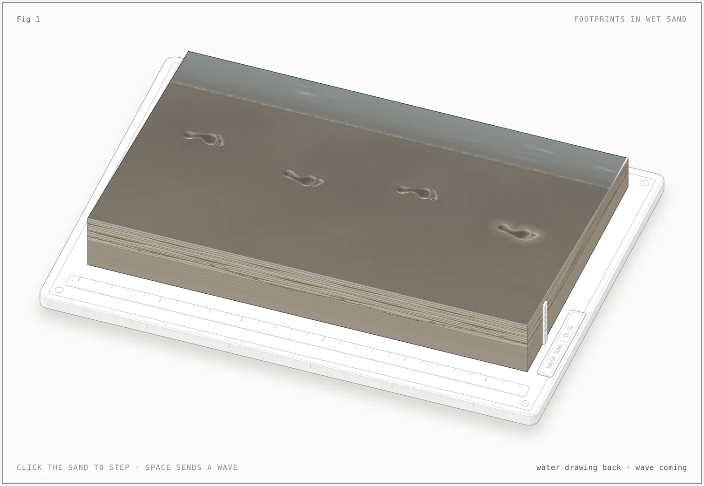 | 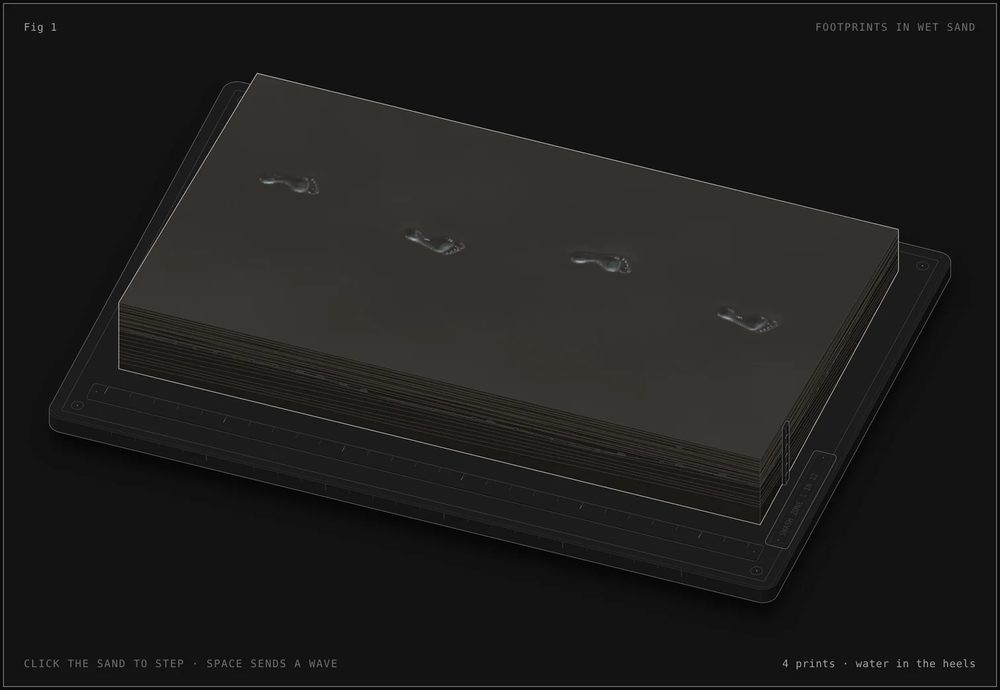 |
| The swash slides in with its foam front | 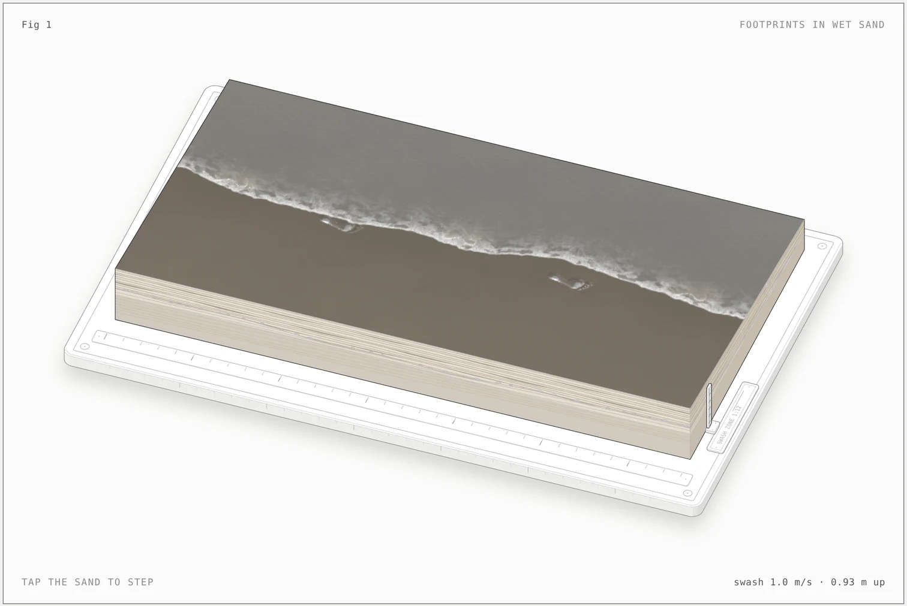 | 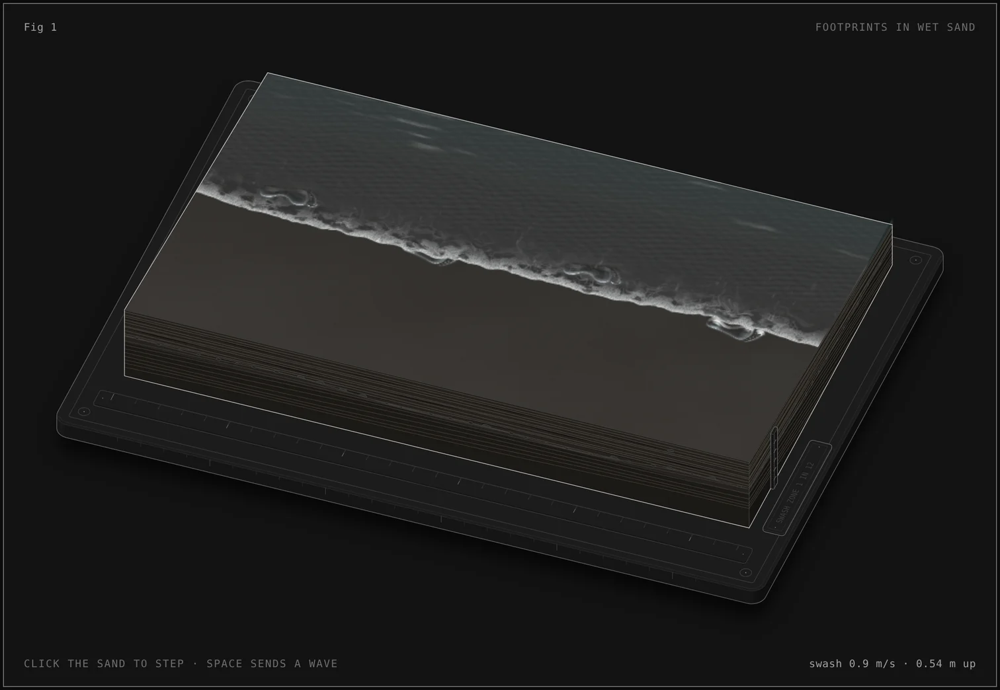 |
| Backwash: the prints are gone, foam is stranded | 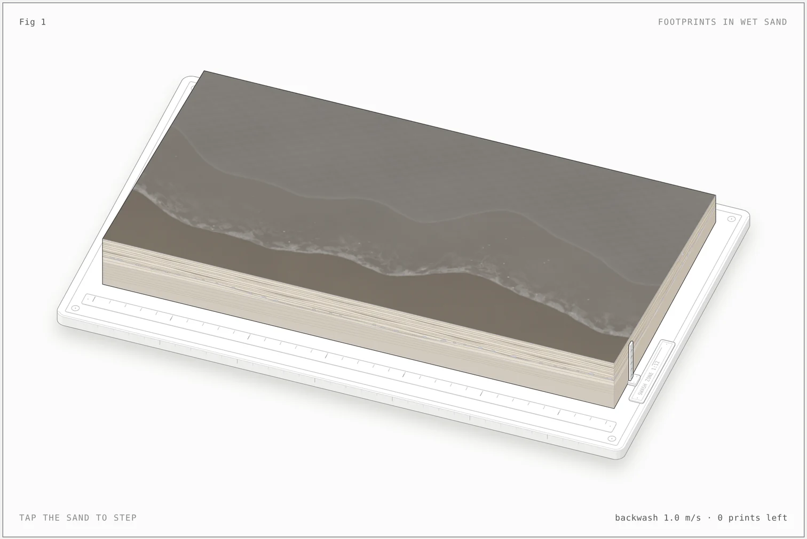 | 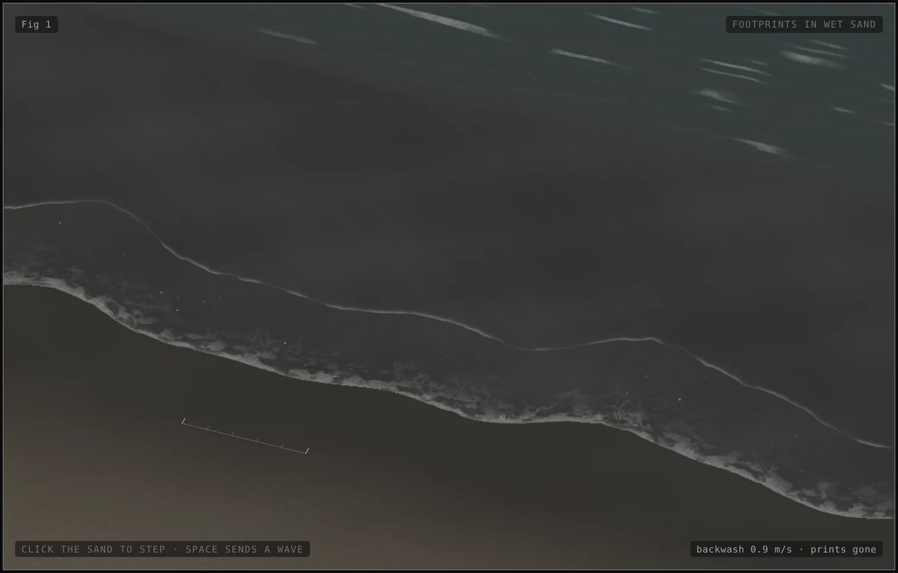 |
| Smooth again, the glossy film draining | 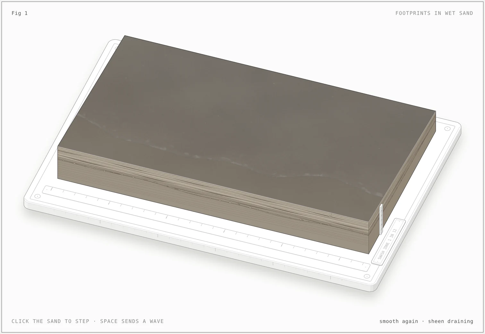 | 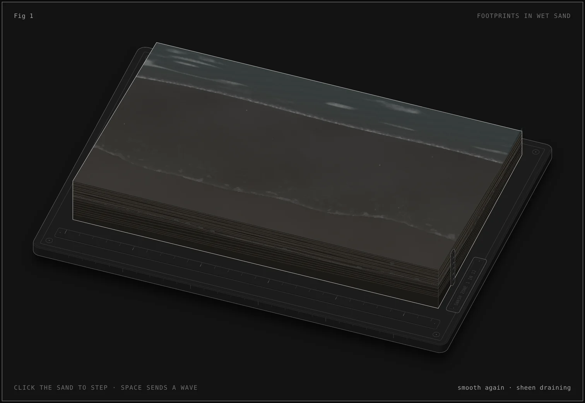 |

The loop runs on its own:

1. All the while, small wavelets cross the shallows at the back and lap up the sand, each one running in, thinning and drawing back.
2. Footprints press in one step at a time, heel first and rolling to the toes. While each foot is down, the sand around it turns pale (Reynolds' dilatancy: the sheared grains dilate and draw the water down). When the foot lifts, water seeps back and pools in the heel and the ball.
3. The lapping stops and the waterline draws back a few centimetres. Then a bore runs in across the shallows, slowing as they shoal, and collapses at the waterline. Its swash shoots up the slope with a foam front, slowing at g·sin β, and covers the prints (Shen and Meyer's ballistic run-up).
4. For a moment each print shows through the thin sheet. Then its rim slumps, the stirred-up sand clouds the water over it, and it is smoothed away.
5. The backwash drains back down the same path, its thin edge retreating over darker, glassy sand, and leaves stranded foam and a swash line at the top of the run-up.
6. The sand is smooth again. The glossy film sinks in, a few grains glint as it drains, and the lapping comes back.

Tap or click the sand to press a footprint there. The right arrow key takes the next step, and Space or Enter sends a wave. The sand holds ten prints; beyond that the oldest slumps away. The idle loop comes back about four seconds after you stop. With reduced motion the figure holds one frame, the swash about to cover the prints, and Space shows the smooth sand after the wave.

## Files

| File | What it is |
|---|---|
| `footprints-in-wet-sand-light.html`, `footprints-in-wet-sand.html` | The built pages, light and dark. Open either in a browser; no server needed. |
| `model.mjs` | The truth: strip geometry, gait, the footprint's sole outline and pressure map, the swash (run-up, lens depth, exposure, erosion) and the loop timeline. The build, the readout, the caption and the shader all read it. |
| `build.mjs` | Builds the SVG half with the Anatomy kit (plinth on feet, ruler, label plate, depth scale, and the beach block with its cut faces: swash laminae, heavy-mineral bands, a storm scour with a shell and pebble lag, older steeper laminae, the water table and a buried wedge clam), then writes the pages. |
| `live.js` | The WebGL layer and the loop: a heightfield march for the prints in the figure's own isometric camera, the seep pools, the dilatancy ring, the swash sheet with its foam front and ripples, erosion, the drained sheen, plus pointer and keyboard input, the SVG fallback and reduced motion. |
| `sand.css` | Theme tokens for the sand, water, foam and section. |
| `kit/` | `iso-kit.mjs` and `gl.mjs` from the Anatomy kit, MIT licensed (see `kit/LICENSE`). |
| `shots/` | The screenshots above. |

## Build

```sh
node build.mjs            # dark page
node build.mjs --light    # light page
node build.mjs --artifact out.html   # a theme-following page body for embedding
```

Node 20.10 or later; no dependencies. The pages expose `window.__fpSeek(seconds)`, which replays the loop deterministically to a given time and holds it there; the screenshots were taken with it and the Anatomy skill's `scripts/drive.mjs`.

## The physics it follows

- **Shallows and bore.** The wavelets cross the shallows at about 0.4 m/s, close to √(g·h) for water a couple of centimetres deep, and each runs a few centimetres up the sand. Before the bigger wave the waterline draws down, as the trough ahead of it arrives, and the bore slows from about 0.9 to 0.7 m/s as it shoals.
- **Swash.** The front moves as a ballistic particle on the slope, `y(t) = y₀ + u₀t − ½·g·sin β·t²`, and the sheet behind it has the Shen–Meyer lens depth `h = (y_front − y)² / (9·g·t²)`. So the front decelerates steadily, turns, and drains back the same way, and the sheet is only millimetres deep. Each wave varies its launch speed slightly along the shore, which gives the lobed front.
- **Erosion.** Each point of a print loses relief with the time it spends under the moving sheet, along a smooth S-curve that reaches zero after 1.4 s of cover: the print holds for a moment, its rim and walls slump, and the bowl fills. That rate is chosen to match how quickly prints vanish on a real beach, not derived: the true rate depends on the grain size, how saturated the bed is and the shear stress of the flow. A print high on the beach that the sheet only grazes keeps what it lost, and the next wave starts from there.
- **Dilatancy.** While a foot loads the sand, the grains around it shear and dilate, the pore water drains into the new space, and the surface pales. After the foot lifts, the water returns. The ring travels from heel to toe with the load.

References: O. Reynolds (1885), *On the dilatancy of media composed of rigid particles in contact*, Phil. Mag. 20; M. C. Shen and R. E. Meyer (1963), *Climb of a bore on a beach, part 3: run-up*, J. Fluid Mech. 16; D. H. Peregrine and S. M. Williams (2001), *Swash overtopping a truncated plane beach*, J. Fluid Mech. 440.
